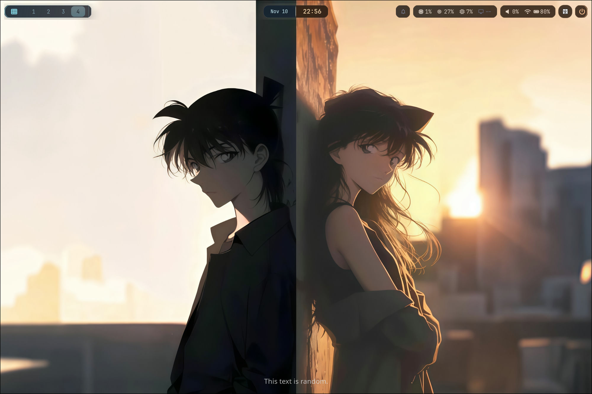
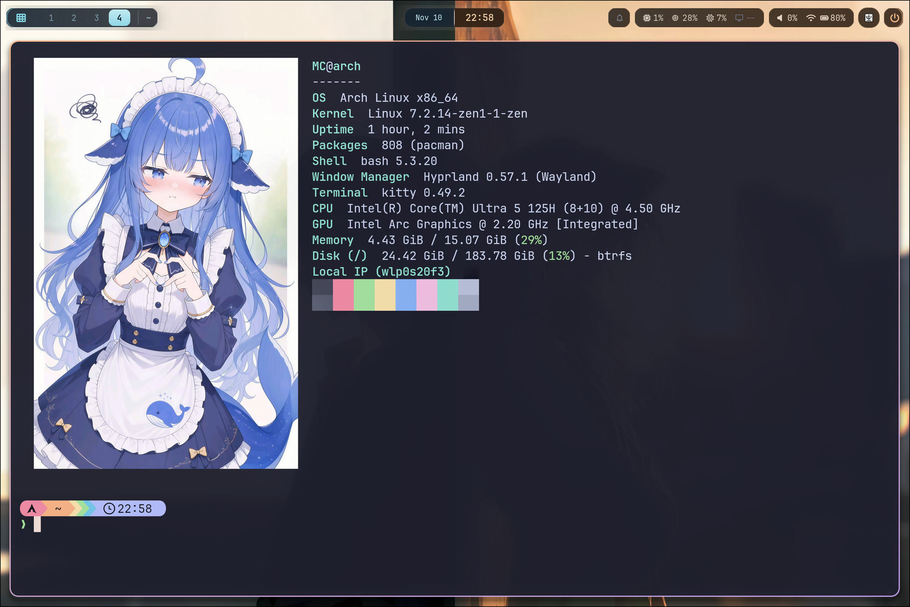

<div align="center">

# 🐟 MC's Dotfiles

**Arch Linux · Hyprland · Wayland · Catppuccin Mocha**

个人 Hyprland 桌面配置存档。

[](https://archlinux.org/)
[](https://hypr.land/)
[](https://wayland.freedesktop.org/)
[](https://catppuccin.com/)

</div>

## 📸 预览

### 桌面



### 终端



## 📂 文件路径

```text
.
├── config/
│   ├── hypr/
│   │   ├── hyprland.lua
│   │   ├── hyprland.conf
│   │   ├── hyprpaper.conf
│   │   ├── hyprlock.conf
│   │   └── hypridle.conf
│   ├── kitty/
│   │   ├── kitty.conf
│   │   └── kittyback.conf
│   ├── waybar/
│   │   ├── config.jsonc
│   │   ├── style.css
│   │   ├── theme.css
│   │   └── scripts/
│   │       ├── brightness.sh
│   │       ├── power.sh
│   │       └── setup-ddc.sh
│   ├── swaync/
│   │   ├── config.json
│   │   └── style.css
│   ├── fastfetch/
│   │   ├── config.jsonc
│   │   ├── logo.png
│   │   └── random-logo.sh
│   ├── fcitx5/
│   │   ├── config
│   │   ├── profile
│   │   └── conf/
│   │       └── notifications.conf
│   └── starship.toml
├── shell/
│   └── bashrc
├── wallpapers/
│   ├── current-desktop.png
│   ├── hyprlock-2.jpg
│   ├── 1.jpg
│   ├── 收藏/
│   │   ├── deepseek-bao-shoubing.png
│   │   ├── deepseek-jushou-jiayou.jpg
│   │   ├── 【哲风壁纸】AI拟人形象-deepseek.jpg
│   │   ├── 【哲风壁纸】Q版-wink.jpg
│   │   ├── 【哲风壁纸】二次元-兽耳(1).jpg
│   │   └── 【哲风壁纸】二次元-兽耳.jpg
│   └── video/
│       └── 1.mp4
├── docs/
│   ├── desktop.jpg
│   └── terminal.jpg
├── MANIFEST.sha256
└── README.md
```

## 📄 文件说明

| 路径 | 内容 |
| --- | --- |
| `config/hypr/hyprland.lua` | Hyprland 主配置 |
| `config/hypr/hyprland.conf` | 空占位文件 |
| `config/hypr/hyprpaper.conf` | 桌面壁纸 |
| `config/hypr/hyprlock.conf` | 锁屏 |
| `config/hypr/hypridle.conf` | 空闲管理 |
| `config/kitty/kitty.conf` | Kitty 终端配置 |
| `config/kitty/kittyback.conf` | 旧版 Kitty 配置 |
| `config/waybar/config.jsonc` | Waybar 布局 |
| `config/waybar/style.css` | Waybar 样式 |
| `config/waybar/theme.css` | Catppuccin 调色板 |
| `config/waybar/scripts/brightness.sh` | 亮度控制脚本 |
| `config/waybar/scripts/power.sh` | 电源菜单脚本 |
| `config/waybar/scripts/setup-ddc.sh` | 外接屏 DDC 初始化脚本 |
| `config/swaync/config.json` | SwayNC 配置 |
| `config/swaync/style.css` | SwayNC 样式 |
| `config/fastfetch/config.jsonc` | Fastfetch 配置 |
| `config/fastfetch/logo.png` | Fastfetch logo |
| `config/fastfetch/random-logo.sh` | 随机 logo 脚本 |
| `config/fcitx5/config` | Fcitx5 配置 |
| `config/fcitx5/profile` | Fcitx5 输入方案 |
| `config/fcitx5/conf/notifications.conf` | Fcitx5 通知配置 |
| `config/starship.toml` | Starship 提示符配置 |
| `shell/bashrc` | Bash 配置 |
| `wallpapers/current-desktop.png` | 当前桌面壁纸 |
| `wallpapers/hyprlock-2.jpg` | 锁屏壁纸 |
| `wallpapers/1.jpg` | 备用壁纸 |
| `wallpapers/收藏/` | 壁纸收藏 |
| `wallpapers/video/1.mp4` | 外接屏动态壁纸 |
| `docs/desktop.jpg` | 桌面截图 |
| `docs/terminal.jpg` | 终端截图 |
| `MANIFEST.sha256` | 文件校验清单 |

---

个人配置存档。壁纸、字体与第三方主题版权归各自原作者所有。
